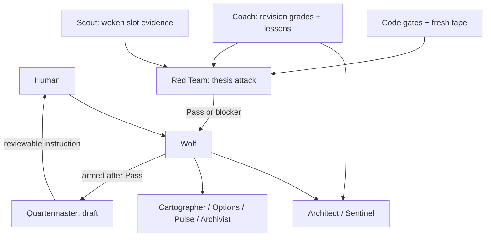

# The desk: 11 agents, one job each

Public design refreshed 2026-10-11. A video-ingest routine feeds the desk; it is not an additional
decision-making role. Wolf owns coordination and arming, specialists own evidence and judgment,
and the human approves the plan and submits orders.

## Seats and workers

The intended Floor seats are **Wolf and Quartermaster**. Everyone else is a worker with a narrow
brief and a database finish record. Wolf relays actionable results. Actual platform membership
must be checked during deployment; it is not established by this file.

| Agent | One job | May | May not |
|---|---|---|---|
| Wolf | Coordinate, resolve blockers, own arming | Dispatch, arm after Pass, relay actionable results | Approve plans, submit live orders |
| Quartermaster | Stage and reconcile broker instructions | Stage the planned-limit draft after an arm | Submit, modify or cancel live orders |
| Architect | BUILD the weekly plan | Draft, score, size within approved limits, read lessons | Approve its own plan |
| Sentinel | Full premarket UPDATE | Refresh non-active levels and claims, add names, sync watchlists | Run without approval, change active-position levels |
| Scout | Intraday tape and evidence | Review woken names, flag entry/promote/stop-risk events | Arm or place orders |
| Red Team | Attack the trade thesis | Evidence-backed Pass / Wait / Fail, record unblock/recheck conditions | Re-score at arm, use Conditional Pass, arm or order |
| Coach | Grade decisions and execution | Match grades to immutable thesis revisions, write/archive lessons, review overrides | Rewrite predictions, mix pilot and main results |
| Cartographer | Describe multi-timeframe structure | Report levels and structure facts | Make the final trade decision |
| Options | Own options evidence and the rate-limited queue | EM/gamma/flow facts, scripted pulls | Exceed budgets, supply the final verdict |
| Pulse | News and public X intelligence | Structured, sourced context; materiality labels | Treat sentiment alone as a signal |
| Archivist | Ingest and archive research | New packs, gated channel reads, remove superseded files | Leave duplicates or invent missing evidence |

## Routing

## A day on the desk (Pacific time)

| Time | Work |
|---|---|
| ~03:35 / ~03:40 | New video transcripts and gated research ingest |
| ~04:00 | Sentinel's full approved-plan UPDATE with specialists |
| ~06:35 | Consolidated scripted options pull in the intended cadence |
| 06:00–13:00, every 5 min | Code checks fresh tape; gated pre-entry/entry/Wait recheck wakes |
| :44 → :45, 06:45–12:45 | Code decides each Scout slot; Grok runs only when there is work |
| :52 | Code decides whether a catch-up is needed; no duplicate slot processing |
| ~10:15 | Gated Pulse material-news check |
| ~13:13 | Coach EOD review |
| Saturday | Coach weekly review; Wolf asks why for overrides |
| Weekend, when enabled | Archive and BUILD; human CONFIRM required |

Market-calendar code handles holidays and half-day closes. Routine enablement is deployment state,
not implied by this schedule. Details: [CADENCE](docs/CADENCE.md), [CONTRACT](CONTRACT.md).
