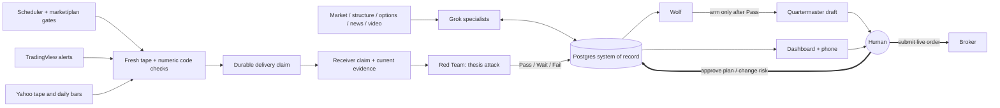
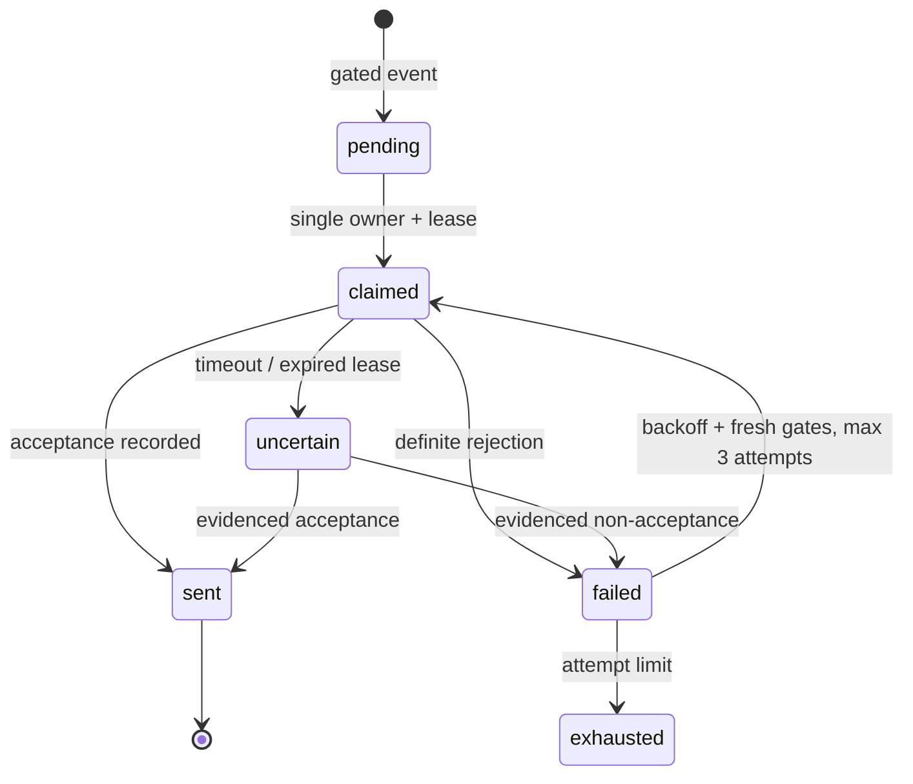
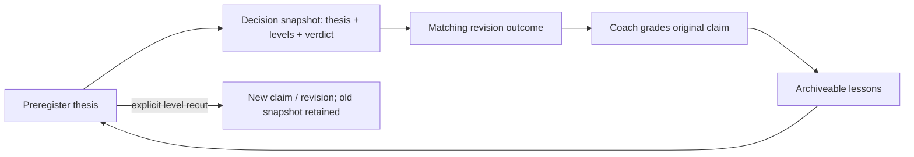

# Architecture

Public design refreshed 2026-10-11. It describes the implemented build while excluding private
plans, levels, accounts, credentials and internal identifiers. Deployment state is separate;
see [BUILD.md](BUILD.md). The diagrams are Mermaid, editable and rendered directly by GitHub.

## 1. System overview



Code notices price events and rejects invalid/stale inputs. Models judge the thesis. Wolf owns
arming; a draft broker instruction still requires human submission. Stop-risk warnings concern
an existing position and go to the human rather than an entry thesis review.

## 2. The three planes

| Plane | Responsibility | Boundary |
|---|---|---|
| Intelligence | Research, synthesis, thesis attack, lessons | Evidence-backed judgment; no live order execution |
| State | Plans, verdicts, receipts, revision snapshots, grades | Constraints/guards, immutable audit history, explicit permissions |
| Execution | Code watchers, alerts, numeric math, transport | Freshness/session gates; human remains at irreversible action |

Short shared core and role cards drive recurring wakes. References are loaded only for an uncovered
rule. A small decision model answers typed sub-questions; it does not compute zones or issue verdicts.

## 3. A week on the desk

BUILD drafts the week; the human approves it. UPDATE refreshes all non-active cards with full
intelligence. During the session, code decides which entry reviews and Scout/catch-up slots need
models. Coach reviews EOD and weekly, with pilot results separated. Holidays and half days are
code gates. [CADENCE](CADENCE.md) describes intended schedules, not verified enabled routines.

## 4. The arm path

```mermaid
sequenceDiagram
    participant C as Code checks
    participant DB as Database
    participant RT as Red Team
    participant W as Wolf
    participant Q as Quartermaster
    participant H as Human
    C->>DB: read preregistered thesis + fresh tape
    Note over C,DB: no thesis / stale tape / hard Fail = stop
    C->>RT: checked numbers + evidence + original thesis
    RT->>DB: immutable decision snapshot and Pass / Wait / Fail
    alt Pass
        RT->>W: Pass
        W->>DB: armed (guards still apply)
        W->>Q: stage planned-limit instruction
        Q->>H: reviewable draft, target and stop
        H->>H: review and submit, or decline
    else Wait or Fail
        RT->>DB: no arm; named recheck/unblock condition
    end
```

The prediction is written at BUILD/UPDATE, never created just because price reached entry.
R:R is measured at the planned limit. Code owns the numeric gates; Red Team supplies the
strongest evidence-backed opposing case. Wait blocks arming just as Fail does.

## 5. Monitoring and durable delivery

All eligible scanner tickers are processed with bounded provider concurrency, timeouts and
rate-limit backoff. Tape older than 120 seconds is skipped. Completed-session daily bars feed
ATR/5DMA, with coalesced cache misses. Provider failure produces a code health alert, no model wake.



Stable event keys identify instant setup/stage/hour events, versioned Wait rechecks and slot/catch-up
events. Re-dip policy is separate from transport retries. A receiver claims the payload key before
analysis and marks completion. Sent means transport acceptance, not completed analysis. Unknown
effects require reconciliation. This does not guarantee exactly-once execution.

Quiet Scout slots finish in code. Approaching is a label, not a scheduled-slot wake. Entry,
armed-at-entry, stop risk, promote candidates and missing levels can need a model; bad provider
data cannot. Catch-ups re-read current evidence and do not repeat finished work.

## 6. The prediction loop



Current card edits cannot rewrite a recorded decision. Legacy evidence without a trustworthy
revision is excluded from accuracy. Details: [PREDICTION-LOG](PREDICTION-LOG.md).

## 7. Data model (simplified)

| Record | Purpose |
|---|---|
| Plans / setups / positions | Approved plan, current thesis/levels/verdict, actual exposure |
| Decision snapshots / revision outcomes | Immutable decision-time facts and matching grade |
| Wake deliveries / receiver receipts | Single-owner transport, retry/uncertainty state, completion |
| Slot runs / catch-up runs / Floor events | Why work ran or was skipped; worker finishes and human-room mirror |
| Asset prices | Observed quote and independent hourly/daily/weekly bars/timestamps |
| Lessons / notifications | Review feedback and an auditable phone outbox |

The [starter schema](../templates/schema.sql) demonstrates a subset. It is neither a production
export nor a complete deployment, and its role/approval permissions must be configured separately.

## 8. Dashboard and chart caches

Board refreshes fetch quote fields without OHLC history. Reads are cached by table, selectively
invalidated and coalesced; an obsolete response cannot overwrite a newer render. Hidden pages
pause periodic refresh. Charts fetch on opening, not for the entire board on page load.

The bars function refreshes only expired frames: hourly 10 minutes, daily 6 hours, weekly 24 hours.
A cross-isolate owner lease prevents overlapping refreshes. Successful frames alone get stamped;
partial failures retain stale bars. Quote observation time is never a bar freshness timestamp.
Legacy responses without frame timestamps display freshness unknown.

## 9. Deployment and measurement

Schema dependencies first, receiver guards next, then functions/senders. Verify enabled schedules,
stored prompts, dry runs, chart load and one controlled event. A Git merge is not a backend deploy.
Metrics distinguish event count, attempts, accepted sends and completed receivers. Payload bytes
are only a proxy; hosted tokens/cost require provider usage records. No token-saving or trading
performance percentage is claimed. New free sources remain proposals, not integrated providers.

The intended Floor is thin: Wolf and Quartermaster, with database finishes from workers. Actual
membership needs app verification. [CONNECTORS](CONNECTORS.md) describes access boundaries.
